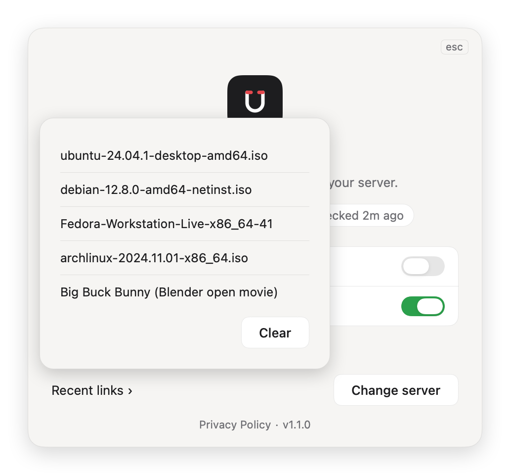

<picture>
  <source media="(prefers-color-scheme: dark)" srcset="assets/readme/hero-dark.png">
  
</picture>

# MagnetRelay

**Click a magnet link. It lands on your home server.**

MagnetRelay is a small menu bar app for your Mac. It becomes the handler for `magnet:` links, so whatever you click in a browser or mail app goes straight to the download app on your NAS or home server.

## Get it

**Mac App Store: coming soon.**
<!-- TODO: App Store URL -->

Or [build it from source](#build-from-source). MagnetRelay needs macOS 13 Ventura or later.

## How it works

1. **Pick your app.** The one that runs downloads on your server or NAS.
2. **Enter its address.** The one you'd type in a browser to open its web page.
3. **Sign in.** The same login you use on that page. Your password goes in your Keychain.

<p align="center">
  
  
  
</p>

MagnetRelay checks the connection, and you're set. From now on every magnet link you click goes to your server, and a notification tells you it was sent.

<p align="center">
  <picture>
    <source media="(prefers-color-scheme: dark)" srcset="assets/screenshots/ready-dark.png">
    
  </picture>
</p>

Open it again from the menu bar under **Settings…**. It's a small panel that gets out of your way: press Esc, or just click somewhere else.

## Send it again

The last five links you sent stay on your Mac. Pick one from **Recent links**, or from the menu bar, and it goes to your server again.

<p align="center">
  
</p>

## Works with

| App | Default port | Good to know |
|---|---|---|
| qBittorrent | 8080 | Switch on the Web UI. |
| Transmission | 9091 | Switch on remote access. |
| Deluge | 8112 | Password only, no username. If the Web UI isn't connected to a daemon, MagnetRelay connects it to the first host in the list. |
| rTorrent | 8080 | Through an XML-RPC web front end. The path `/RPC2` is filled in for you. |
| Synology Download Station | 5000 (HTTP), 5001 (HTTPS) | HTTPS is required outside your home network. Plain HTTP is fine for local and private addresses, `.local` names and single-word names like `diskstation`. |

## Privacy

MagnetRelay has no analytics, no tracking and no account. It only talks to the server you set up. Your settings and recent links stay on your Mac, and your password stays in the macOS Keychain. The details are in the [Privacy Policy](PRIVACY.md).

## FAQ

<details>
<summary><b>Does it download anything?</b></summary>

No. MagnetRelay only passes the link to your own download app. The files are downloaded by your server, never by your Mac.

</details>

<details>
<summary><b>Where is my password stored?</b></summary>

In the macOS Keychain, separate from the other settings. It is never written to a file in plain text and never leaves your Mac except to sign in to your own server.

</details>

<details>
<summary><b>My client is behind a reverse proxy.</b></summary>

On the address step choose **Add a path** and enter the sub-path, for example `/qbittorrent`. Use port 443 and switch on **Use HTTPS** if the proxy serves HTTPS.

</details>

<details>
<summary><b>Synology says HTTPS is required.</b></summary>

MagnetRelay only sends your password over plain HTTP on your home network: local and private addresses, `.local` names and single-word names like `diskstation`. For anything else, switch on **Use HTTPS** and use port 5001 (or your reverse proxy's HTTPS port).

</details>

## Build from source

MagnetRelay is Swift and SwiftUI with no third-party dependencies. You need Xcode and [XcodeGen](https://github.com/yonaskolb/XcodeGen).

```bash
git clone https://github.com/n0dal/MagnetRelay.git
cd MagnetRelay
brew install xcodegen
xcodegen generate
xcodebuild -project MagnetRelay.xcodeproj -scheme MagnetRelay -configuration Debug build
```

The repo map, tests, screenshot tools and gotchas are in [docs/DEVELOPMENT.md](docs/DEVELOPMENT.md).

## License & disclaimer

[MIT](LICENSE). Please read the [disclaimer](DISCLAIMER.md) before use. Security issues: see [SECURITY.md](SECURITY.md). What the app is built on: [THIRD_PARTY_NOTICES.md](THIRD_PARTY_NOTICES.md).

MagnetRelay forwards links to a server you run and downloads nothing itself. What your server downloads is up to you; use it for content you have the right to get, like Linux ISOs and open-source releases.

MagnetRelay is not affiliated with, endorsed by, or sponsored by Apple, the qBittorrent, Transmission, Deluge or rTorrent projects, or Synology Inc. All trademarks belong to their respective owners.
