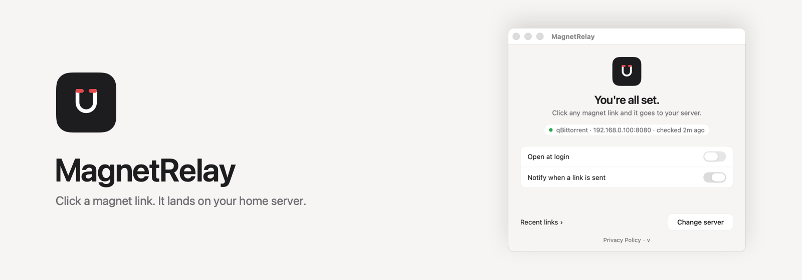
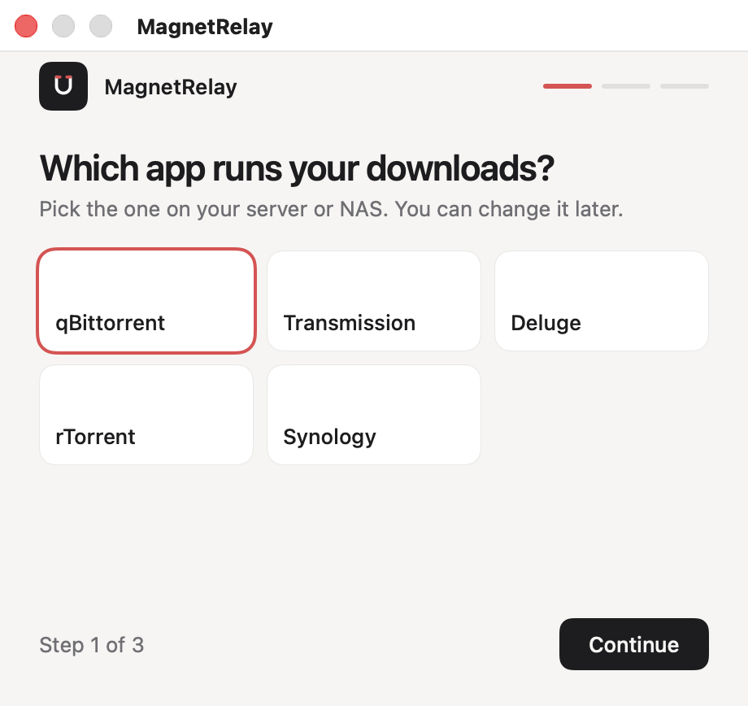
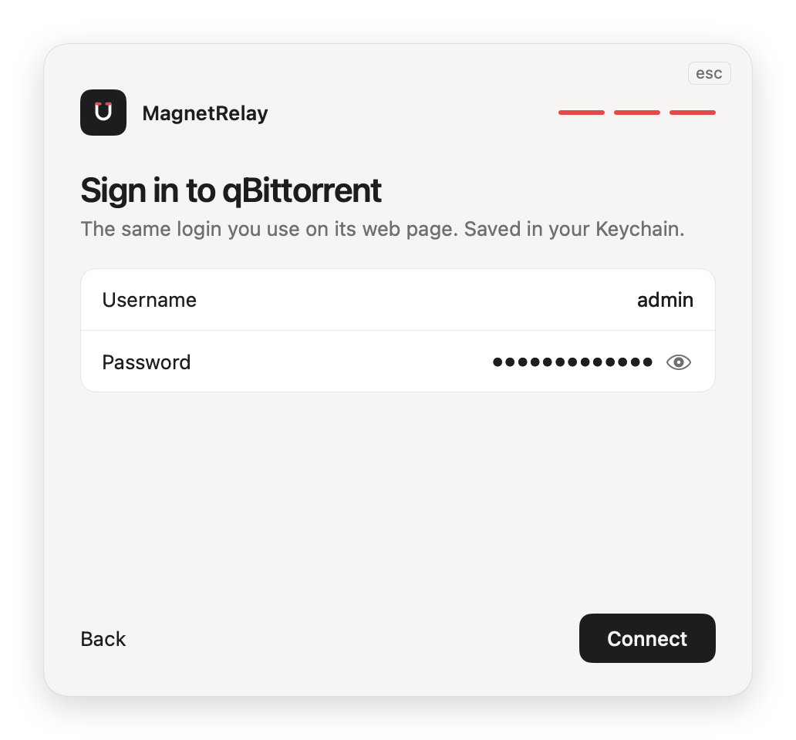

<picture>
  <source media="(prefers-color-scheme: dark)" srcset="assets/readme/hero-dark.png">
  
</picture>

# MagnetRelay

**Click a magnet link. It lands on your home server.**

MagnetRelay is a small menu bar app for macOS. It becomes your Mac's handler for `magnet:` links, so a click in any browser or mail app is sent straight to the download app on your NAS or home server.

[Download](#download) · [How it works](#how-it-works) · [Supported clients](#supported-clients) · [Privacy](#privacy) · [FAQ](#faq) · [For tinkerers](#for-tinkerers)

---

## Download

**Mac App Store: coming soon.**
<!-- TODO: App Store URL -->

Or [build it from source](#for-tinkerers). Requires macOS 13 (Ventura) or newer.

## How it works

1. **Pick your client.** Choose the app that runs on your server or NAS.
2. **Enter its address.** The one you would type in a browser to open its web page.
3. **Sign in.** The same login you use on that web page. Your password is saved in your Keychain.

<p align="center">
  
  
  
</p>

When the connection test passes you are done. From then on, clicking a magnet link anywhere on your Mac sends it to your server and shows a notification. The menu bar keeps your last 5 links, so you can send one again.

<p align="center">
  
</p>

## Supported clients

| Client | Default port | Notes |
|---|---|---|
| qBittorrent | 8080 | Web UI must be switched on. |
| Transmission | 9091 | Remote access must be switched on. |
| Deluge | 8112 | Password only, there is no username. The Web UI must be connected to a daemon; if it is not, MagnetRelay connects it to the first host in the list. |
| rTorrent | 8080 | Reached through an XML-RPC web front end. The path is `/RPC2` and is filled in for you. |
| Synology Download Station | 5000 (HTTP), 5001 (HTTPS) | HTTPS is required outside your home network. Plain HTTP is allowed for local and private addresses, and for single-word names like `diskstation`. |

## Privacy

- No analytics, no tracking, no account.
- The only network connection is to the server you set up.
- Settings stay on your Mac; the last 5 links are kept locally so you can resend them.
- Your password lives in the macOS Keychain.

Read the full [Privacy Policy](PRIVACY.md).

## FAQ

<details>
<summary><b>Does it download anything?</b></summary>

No. MagnetRelay only passes the link to your own download app. The files are downloaded by your server, never by your Mac.

</details>

<details>
<summary><b>Where is my password stored?</b></summary>

In the macOS Keychain, separate from the other settings. It is never written to a file in plain text and never leaves your Mac except to sign in to your own server.

</details>

<details>
<summary><b>My client is behind a reverse proxy.</b></summary>

On the address step choose **Add a path** and enter the sub-path, for example `/qbittorrent`. Use port 443 and switch on **Use HTTPS** if the proxy serves HTTPS.

</details>

<details>
<summary><b>Synology says HTTPS is required.</b></summary>

MagnetRelay only sends your password over plain HTTP on your home network: local and private addresses, `.local` names and single-word names like `diskstation`. For anything else, switch on **Use HTTPS** and use port 5001 (or your reverse proxy's HTTPS port).

</details>

## For tinkerers

MagnetRelay is Swift and SwiftUI, with no third-party dependencies. The Xcode project is generated by [XcodeGen](https://github.com/yonaskolb/XcodeGen).

```bash
git clone https://github.com/n0dal/MagnetRelay.git
cd MagnetRelay
brew install xcodegen
xcodegen generate
xcodebuild -project MagnetRelay.xcodeproj -scheme MagnetRelay -configuration Debug build
```

Run the tests (unsigned, no developer account needed):

```bash
xcodebuild test -project MagnetRelay.xcodeproj -scheme MagnetRelay -destination 'platform=macOS' \
  CODE_SIGN_IDENTITY="-" CODE_SIGNING_REQUIRED=NO CODE_SIGNING_ALLOWED=NO -quiet
```

`python3 Tests/mock_synology.py` starts a fake Synology server for trying the app without hardware, and `Tests/visual_tests.sh` captures a screenshot of every screen. Visual tests should run against a signed build. The repo map, every command and the gotchas are in [docs/DEVELOPMENT.md](docs/DEVELOPMENT.md).

## License

[MIT](LICENSE)
